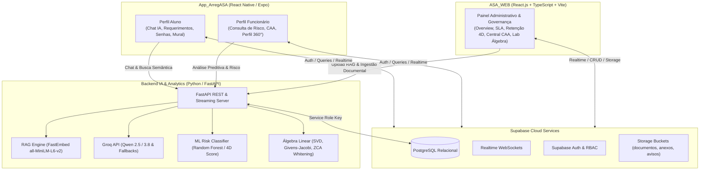
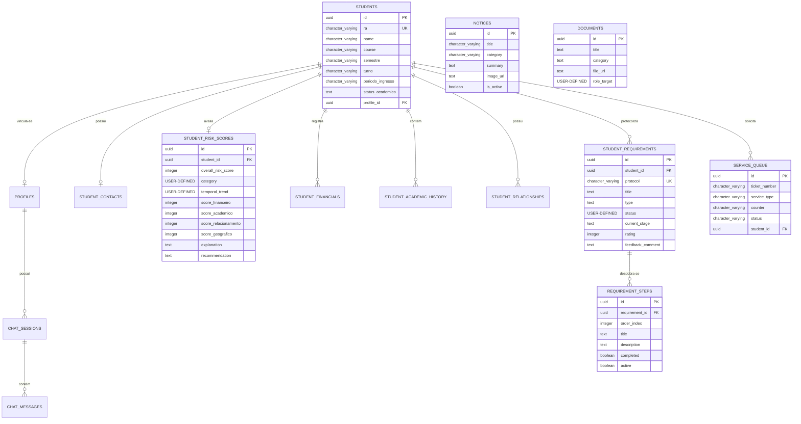

# FECAP - Fundação de Comércio Álvares Penteado

<p align="center">
<a href="https://www.fecap.br/"></a>
</p>

# Projeto Integrador - Inteligência Artificial e Aprendizado de Máquina

## Nome do grupo: SISA - Sistema Inteligente do Sucesso Alvarista

## Integrantes:

| [<br><sub>Rafael Marques</sub>](https://www.linkedin.com/in/rafael-marques-6488642a9/) | [<br><sub>Lucas Alves Bernardo</sub>](https://www.linkedin.com/in/lucas-alves-bernardo-093871252/) | [<br><sub>Larissa de Almeida Lira Oliveira</sub>](https://www.linkedin.com/in/larissa-de-almeida?utm_source=share&utm_campaign=share_via&utm_content=profile&utm_medium=android_app) | [<br><sub>Vinicius Cardoso de Lima</sub>](https://www.linkedin.com/in/vinicius-cardoso-de-lima-a9a918227/) |
| :---: | :---: | :---: | :---: |

## Professores Orientadores: <a href="https://www.linkedin.com/in/rafael-diogo-rossetti/">Rafael Diogo Rossetti</a>

---

## 📌 Descrição do Projeto

<p align="center">

<br>
Logo do <a href="https://www.fecap.br/asa/">ASA</a> - <a rel="license" href="https://creativecommons.org/licenses/by-sa/3.0/">CC BY-SA 3.0</a>
</p>

A **Área do Sucesso Alvarista (ASA)** acolhe e acompanha os estudantes ao longo de sua trajetória na FECAP, com foco prioritário no acolhimento, na permanência e no sucesso acadêmico. A área integra uma equipe multidisciplinar e uma ampla cesta de serviços institucionais relacionados à biblioteca, apoio psicopedagógico, financiamento e bolsas, empregabilidade e relacionamento acadêmico.

Com o objetivo de tornar o atendimento mais ágil, consistente e proativo, este Projeto Integrador do 5º semestre do curso de **Ciência da Computação da FECAP** concebeu e implementou o **SISA (Sistema Inteligente do Sucesso Alvarista)**: um ecossistema multiplataforma de inteligência artificial aplicada, composto por:

1. **Aplicativo Mobile (`ASA_Mobile`)**: Plataforma para Alunos e Funcionários com autoatendimento inteligente, triagem preditiva, chat com IA generativa (RAG), acompanhamento de requerimentos, fila presencial de senhas e transbordo para atendimento humano.
2. **Plataforma Web Administrativa (`ASA_WEB`)**: Painel de governança acadêmica e gestão estratégica em tempo real para gestores do ASA, com monitoramento de SLA, triagem operacional, agentes analíticos e painéis de permanência estudantil.
3. **Backend Analítico & Motor de IA (Python / FastAPI)**: Orquestrador de Recuperação Aumentada por Geração (RAG), inferência LLM via Groq, pipelines de Machine Learning para predição de risco de evasão e transformações matriciais de Álgebra Linear aplicada a embeddings.
4. **Infraestrutura em Nuvem (Supabase)**: Banco de dados PostgreSQL relacional, sincronização bidirecional via WebSockets (Realtime), autenticação com controle de acesso baseado em papéis (RBAC) e armazenamento de arquivos em Object Storage.

---

## 💡 Benefícios da Solução

### Para o Estudante
- **Atendimento Imediato 24/7**: Respostas rápidas e confiáveis sobre regulamentos, bolsas, rematrícula e calendário acadêmico via Agente SISA ancorado em documentos oficiais (RAG).
- **Transparência em Requerimentos**: Abertura assistida por IA e rastreamento completo de cada etapa de tramitação com histórico de despachos e prazos de SLA.
- **Integração CAA Físico-Digital**: Retirada e acompanhamento de senhas de atendimento presencial diretamente no celular, com notificação de chamada de guichê.
- **Comunicação Direta**: Mural institucional dinâmico e canal de chat com transbordo instantâneo para atendentes humanos quando necessário.

### Para os Colaboradores e Atendentes da CAA
- **Redução de Carga Operacional Repetitiva**: Resolução automatizada de dúvidas frequentes (alta taxa de deflexão) liberando a equipe para casos complexos.
- **Painel de Senhas e Atendimento ao Vivo**: Gestão ágil de guichês, filas presenciais e atendimento via chat com visualização do histórico prévio do aluno.
- **Triagem Estruturada de Requerimentos**: Validação centralizada de anexos oficiais e avanço de etapas de conformidade com SLA.

### Para a Gestão e a FECAP
- **Prevenção Ativa da Evasão Estudantil**: Identificação antecipada de alunos em risco por meio de modelo preditivo multidimensional (Score 4D).
- **Tomada de Decisão Baseada em Dados Reais**: Monitoramento contínuo de 22+ indicadores operacionais e acadêmicos sem estimativas sintéticas.
- **Governança de Conhecimento**: Indexação dinâmica de novos documentos institucionais no acervo RAG sem interrupção de serviço.

---

## 🏛 Arquitetura do Ecossistema



---

## 🗄 Modelagem do Banco de Dados (Supabase PostgreSQL)

A base de dados é unificada entre o aplicativo mobile (`App_ArregASA`) e o painel web (`ASA_WEB`), estruturada em PostgreSQL com Row Level Security (RLS) e publicações Realtime ativas.

### Diagrama Entidade-Relacionamento



### Detalhamento das Entidades Principais

| Tabela | Finalidade Principal | Campos Relevantes |
| :--- | :--- | :--- |
| `public.students` | Cadastro acadêmico mestre dos discentes da FECAP | `id`, `ra`, `name`, `course`, `semestre`, `turno`, `status_academico`, `profile_id` |
| `public.student_risk_scores` | Indicadores de risco calculados pelo modelo de permanência | `student_id`, `overall_risk_score`, `category` (Verde/Amarelo/Vermelho), `score_financeiro`, `score_academico`, `score_relacionamento`, `score_geografico`, `temporal_trend`, `recommendation` |
| `public.student_requirements` | Protocolos de requerimentos e solicitações acadêmicas | `id`, `student_id`, `protocol`, `title`, `type`, `status` (pending/in_progress/approved/rejected), `current_stage`, `rating` (CSAT 1-5), `feedback_comment` |
| `public.requirement_steps` | Etapas do fluxo de tramitação de cada requerimento | `id`, `requirement_id`, `order_index`, `title`, `description`, `completed`, `active`, `step_date` |
| `public.student_financials` | Parcelas, histórico de pagamentos e status de bolsas | `student_id`, `servico_parcela`, `parcela`, `valor_original`, `status_parcela`, `data_vencimento`, `bolsa_aluno` |
| `public.student_academic_history` | Rendimento semestral por disciplina e faltas | `student_id`, `disciplina`, `ano_semestre_letivo`, `nota_obtida`, `faltas_lancadas`, `pct_assiduidade`, `situacao` |
| `public.student_contacts` | Dados demográficos e endereço do estudante | `student_id`, `bairro`, `cidade`, `estado`, `idade`, `estado_civil`, `sexo` |
| `public.student_relationships` | Atendimentos anteriores e motivos declarados | `student_id`, `codigo_atendimento`, `tema_relacionamento`, `motivo_contato`, `motivo_evasao`, `alternativa_permanencia` |
| `public.service_queue` | Fila presencial de senhas e guichês físicos da Central ASA | `ticket_number`, `service_type`, `counter`, `status` (waiting/called/in_service/completed/cancelled), `student_id` |
| `public.notices` | Mural de comunicados e informes institucionais | `title`, `category`, `summary`, `content`, `badge`, `image_url`, `target_audience`, `is_active` |
| `public.chat_sessions` & `chat_messages` | Sessões de chat da IA SISA e do atendimento humano | `session_id`, `sender` (user/assistant/staff), `text`, `quick_replies`, `suggested_action`, `rating` |
| `public.documents` | Acervo de regulamentos e arquivos oficiais do RAG | `title`, `category`, `role_target`, `file_url`, `validity`, `auth_code_prefix` |
| `public.profiles` | Perfis de usuários autenticados e RBAC | `id`, `name`, `email`, `ra`, `role` (Aluno/Funcionário/Admin), `course`, `semester` |

---

## 📱 Funcionalidades do Aplicativo Mobile (`ASA_Mobile`)

O aplicativo móvel foi construído em React Native com ecossistema Expo, provendo interfaces dinâmicas conforme o perfil autenticado:

### 1. Perfil Aluno
- **Assistente Virtual SISA**: Chat interativo integrado à LLM via Groq, habilitado com contexto das grades de aulas, docentes, salas e regulamentos da FECAP.
- **Abertura Inteligente de Requerimentos**: O agente identifica a intenção do aluno durante a conversa, preenche os parâmetros da solicitação e submete o protocolo diretamente ao banco.
- **Acompanhamento de Requerimentos**: Visualização de prazos de SLA, status e timeline detalhada de etapas com upload de comprovantes/anexos.
- **Fila Virtual da CAA**: Retirada de senhas de atendimento presencial (`Geral`, `Prioritário`, `Financeiro`, `Secretaria`), visualização da posição na fila e notificação ao ser chamado para o guichê.
- **Transbordo para Atendimento Humano**: Alternância suave do chat de IA para atendente da CAA em tempo real via Supabase Realtime caso a demanda exija intervenção humana.
- **Mural de Avisos Institucionais**: Feed com comunicados oficiais, eventos acadêmicos, avisos de rematrícula e filtros por categoria.
- **Grade Curricular e Horários**: Consulta rápida de turmas, disciplinas, salas de aula e horários das aulas regulares e DPs de sábado.
- **Perfil do Estudante & Distância do Campus**: Visualização dos dados cadastrais com cálculo em tempo real da distância em km até o Campus Liberdade da FECAP.

### 2. Perfil Funcionário
- **Busca e Dossiê do Estudante**: Pesquisa rápida de alunos por Nome ou RA com acesso aos indicadores de rendimento, faltas, situação financeira e histórico de contatos.
- **Monitoramento de Risco Acadêmico**: Acesso à listagem estratificada de alunos conforme o Score 4D (Vermelho, Amarelo e Verde).
- **Operação de Atendimento CAA**: Visualização das filas de espera, chamadas de senhas para guichês e gestão de chamados.

---

## 🖥 Plataforma Web Administrativa (<a href="https://asa-web-zeta.vercel.app/">`ASA_WEB`</a>)

O repositório <a href="https://asa-web-zeta.vercel.app/">`ASA_WEB`</a> provê o centro de governança executiva e operacional do ASA, acessado exclusivamente por usuários com role **`Admin`** (`admin@fecap.br`). O painel está conectado à mesma instância do Supabase e sincroniza dados bidirecionalmente via WebSockets em tempo real.

### Cobertura dos 22+ Indicadores de Governança

| Dimensão | Indicadores Implementados em Dados Reais |
| :--- | :--- |
| **Operação CAA & Funcionários** | 1. Requerimentos abertos • 2. Requerimentos solucionados • 3. Requerimentos recorrentes • 4. Horários mais frequentes de atendimento (curva horária + mapa de calor 12x12) • 5. Tempo Médio de Primeira Resposta (TMPR) • 6. Tempo Médio de Resolução (TMR) • 7. Taxa de cumprimento de SLA • 8. Demandas críticas e fora do prazo • 9. Taxa de Resolução no Primeiro Contato (FCR) • 10. Nota de satisfação estudantil (CSAT / NPS) • 11. Fila de atendimento por setor / responsável |
| **Alunos & Permanência** | 12. Taxa de evasão global • 13. Score 4D dos alunos (Financeiro 35%, Acadêmico 30%, Relacionamento 25%, Geográfico 10%) • 14. Índice de alunos em risco acadêmico • 15. Taxa de rematrícula • 16. Principais motivos de desistência e trancamento (Pareto) • 17. Base de dados completa com 7 visões relacionais e exportação CSV |
| **Engajamento Mobile** | 18. Taxa de adoção (estudantes ativos cadastrados no app) • 19. Taxa de abertura de notificações push |
| **Agente IA SISA** | 20. Taxa de deflexão de atendimento • 21. Top dúvidas e lacunas de conhecimento não respondidas (*knowledge gaps*) • 22. Taxa de aceite de resposta pelos alunos |

### Módulos Integrados na Web

1. **Executive Overview (`/`)**: Síntese executiva 360° com cards de KPIs, gráficos de tendência e visão condensada da saúde operacional e discente.
2. **SISA Staff — Agente Analítico de Permanência (`/sisa-analitica`)**: Agente conversacional analítico para coordenadores e gestores. Detecta automaticamente o aluno mencionado na conversa por Nome ou RA, consulta o perfil completo nas tabelas relacionais em tempo real, executa busca vetorial no acervo documental e apoia o diagnóstico de permanência.
3. **Central de Operações CAA (`/central-caa`)**: Painel de atendimento presencial e digital unificado. Conta com controle eletrônico de senhas por guichê (`Guichê 01` a `04`) e módulo de Live Chat para assumir conversas transbordadas do mobile via Realtime com histórico completo.
4. **Triagem de Requerimentos & SLA (`/requerimentos-sla`)**: Fila operacional para despacho de etapas de requerimentos, análise de anexos submetidos pelos discentes e upload de pareceres oficiais no bucket de storage.
5. **Retenção Estudantil & Score 4D (`/retencao-estudantil`)**: Matriz de risco multidimensional, curva de evasão e gráfico de Pareto dos motivos de desistência, além do Dossiê 360° individual do estudante.
6. **Mural de Avisos & Engajamento (`/engajamento-mobile`)**: Gerenciador de comunicados com publicação em tempo real no app mobile, upload de banners de destaque e monitoramento de push notifications.
7. **Centro de Arquivos & Ingestão RAG (`/arquivos-rag`)**: Upload de PDFs com pipeline automático de chunking semântico, geração de embeddings e inserção no índice vetorial do backend em tempo de execução, além de visualizador unificado dos buckets `documentos-asa`, `requerimentos-anexos` e `notices-images`.
8. **Laboratório de Álgebra Linear Aplicada (`/algebra-linear`)**: Módulo demonstrativo com formulação matemática e visualização gráfica 2D/Heatmap da transformação linear aplicada aos 257 embeddings reais de documentos da FECAP:
   - Alinhamento Semântico ($T_W$) via Mínimos Quadrados Regularizados.
   - Isotropização Espectral ($T_{\text{iso}}$ — ZCA Whitening) via autovalores e autovetores por rotações de Givens-Jacobi.
   - Operador composto $T_{\text{SISA}} = T_{\text{iso}} \circ T_W$, com verificação de Posto, Nulidade ($\dim \ker T + \dim \text{Im } T = 12$) e Condicionamento $\kappa_2$.
9. **Explorador da Base de Dados (`/base-dados`)**: Tabela dinâmica de consulta relacional às entidades do Supabase com busca, paginação e exportação para CSV.

---

## 🛠 Arquitetura de Pastas dos Repositórios

### 1. Repositório Mobile & Backend (`ASA_Mobile`)

```text
App_ArregASA/
├── assets/                     # Ícones e splash screen do aplicativo
├── backend/                    # Servidor FastAPI e Inteligência Artificial
│   ├── base_alunos/            # Planilhas institucionais reais (Matrículas, Financeiro, Histórico, etc.)
│   ├── DocumentosASA/          # Acervo oficial de PDFs institucionais da FECAP
│   ├── knowledge_graph/        # Grafo de conhecimento em Markdown indexado
│   ├── agent.py                # Agente conversacional SISA (Groq + RAG + Intenções)
│   ├── chunker.py              # Extrator e divisor de texto em blocos semânticos
│   ├── embeddings.py           # Geração de vetores de embedding com FastEmbed (all-MiniLM-L6-v2)
│   ├── knowledge_engine.py     # Motor de busca em grafo estruturado e regras acadêmicas
│   ├── knowledge_gap_logger.py # Registro persistente de lacunas de conhecimento não respondidas
│   ├── ml_student_risk.py      # Treinamento e cálculo do modelo preditivo de evasão (Score 4D)
│   ├── rag_engine.py           # Motor de busca vetorial por similaridade de cosseno
│   ├── server.py               # Servidor FastAPI com rotas de chat, RAG, upload e risco
│   ├── student_risk_agent.py   # Agente analítico de risco estudantil
│   └── requirements.txt        # Dependências Python (FastAPI, Groq, FastEmbed, scikit-learn)
├── src/                        # Código-fonte do aplicativo React Native
│   ├── assets/                 # Imagens, ilustrações e logos institucionais
│   ├── components/             # Componentes modulares (Admin, Cards, Chat, Modais, Notificações)
│   ├── navigation/             # Navegação por rotas (Stack e Bottom Tabs)
│   ├── screens/
│   │   ├── ai/                 # Telas de chat e assistente virtual SISA
│   │   ├── auth/               # Telas de boas-vindas, login e recuperação de senha
│   │   ├── documents/          # Visualização de acervo institucional e requerimentos
│   │   ├── home/               # Home com dashboards dinâmicos por perfil (Aluno e Funcionário)
│   │   ├── onboarding/         # Apresentação inicial e seleção de papéis
│   │   ├── profile/            # Perfil do aluno, dados pessoais e configurações de tema
│   │   ├── staff/              # Gestão CAA, atendimento, busca e risco discente
│   │   └── student/            # Requerimentos do aluno e timeline
│   ├── services/
│   │   ├── ai-agent/           # Clientes HTTP e lógica local do agente Groq e RAG
│   │   ├── notifications/      # Gerenciamento de tokens e push notifications
│   │   └── supabase/           # Cliente Supabase, autenticação, storage, filas e chat
│   ├── store/                  # Contextos de autenticação (AuthContext) e estado global (AppContext)
│   ├── theme/                  # Definições de tipografia, cores (Dark/Light) e escalonamento
│   └── utils/                  # Formatadores, validadores e geradores de documentos
├── supabase/                   # Configurações do Supabase
│   ├── functions/              # Edge Functions (notificações push e registro de discentes)
│   ├── migrations/             # Scripts SQL de schema, índices, RLS e Realtime
│   └── schema.sql              # Estrutura consolidada do banco relacional
├── app.json                    # Metadados e configuração do Expo
├── package.json                # Dependências do app (React Native 0.74, Expo 51, Lucide)
└── tsconfig.json               # Configurações do compilador TypeScript
```

### 2. Repositório Web Administrativo (`ASA_WEB`)

```text
ASA_WEB/
├── public/                     # Favicon e manifestos estáticos
├── supabase/migrations/        # Migração SQL específica para perfil 'Admin'
├── src/
│   ├── assets/logos/           # Identidade visual oficial ASA FECAP
│   ├── components/
│   │   ├── charts/             # Componentes gráficos (MatrixHeatmap 12x12 e VectorSpace2DPlot)
│   │   ├── common/             # Componentes reutilizáveis (KpiCard, Drawers, Modais de Preview)
│   │   └── layout/             # Shell administrativo com Sidebar responsiva e Topbar Realtime
│   ├── contexts/               # Contextos React (AuthContext com RBAC, ThemeContext, DashboardDataContext)
│   ├── data/                   # Catálogos locais de requerimentos, horários e subespaço semântico
│   ├── features/
│   │   ├── auth/               # Tela de autenticação restrita para administradores
│   │   ├── overview/           # Visão geral executiva com KPIs institucionais
│   │   ├── sisa-staff/         # Agente SISA Analítico de Permanência Estudantil
│   │   ├── caa-operations/     # Painel de senhas presenciais e atendimento ao vivo da CAA
│   │   ├── requirements/       # Gestão de requerimentos, tramitação e métricas de SLA
│   │   ├── retention/          # Retenção 4D, evasão, curva de risco e Dossiê 360°
│   │   ├── engagement/         # Gerenciamento do Mural de Avisos e métricas do mobile
│   │   ├── files-rag/          # Ingestão de PDFs para o RAG e explorador de buckets
│   │   ├── agent-algebra/      # Métricas de deflexão e laboratório de transformações lineares
│   │   └── database/           # Explorador mestre multi-tabelas com exportação CSV
│   ├── lib/
│   │   ├── linearAlgebra/      # Implementações de sistemas lineares, ZCA Whitening e métricas
│   │   └── supabase/           # Cliente Web do Supabase
│   ├── services/               # Serviços de integração (analyticsEngine, adminActionsService, etc.)
│   ├── styles/                 # Estilização global e tokens do Material Design 3
│   ├── types/                  # Tipagem TypeScript de todas as tabelas e métricas do ecossistema
│   └── utils/                  # Formatadores de datas, moeda e exportação de CSV
├── package.json                # Dependências Web (React 18, Vite, Recharts, Lucide, Supabase-js)
├── vite.config.ts              # Configurações de compilação do Vite
└── tsconfig.json               # Configurações de tipagem TypeScript
```

---

## 💻 Configuração e Execução para Desenvolvimento

### Pré-requisitos
- **Node.js** (versão 18.x ou superior)
- **Python** (versão 3.10 ou superior)
- **Expo CLI** (`npm install -g expo-cli`)
- Chave de API do **Groq** e instância configurada do **Supabase**

---

### 1. Execução do Backend Inteligente (Python / FastAPI)

Navegue até a pasta raiz do projeto mobile:

```bash
cd "C:\Users\..."
cd backend
```

Crie e ative um ambiente virtual:

```bash
# Windows
python -m venv venv
.\venv\Scripts\activate
```

Instale as dependências:

```bash
pip install -r requirements.txt
```

Configure as variáveis no arquivo `.env` dentro de `backend/`:

```env
GROQ_API_KEY=sua_chave_groq_aqui
GROQ_MODEL=qwen/qwen3.8-27b
SUPABASE_URL=https://hevywbfvoooybuxxewwp.supabase.co
SUPABASE_SERVICE_ROLE_KEY=sua_chave_service_role_aqui
```

Inicie o servidor da API:

```bash
python server.py
# O servidor iniciará em http://127.0.0.1:8000
# A documentação interativa estará acessível em http://127.0.0.1:8000/docs
```

---

### 2. Execução do Aplicativo Mobile (`ASA_Mobile`)

No diretório raiz de `ASA_Mobile`:

```bash
cd "C:\Users\..."
npm install
```

Configure o arquivo `.env` na raiz do app:

```env
EXPO_PUBLIC_SUPABASE_URL=https://hevywbfvoooybuxxewwp.supabase.co
EXPO_PUBLIC_SUPABASE_ANON_KEY=sua_chave_anon_aqui
EXPO_PUBLIC_GROQ_API_KEY=sua_chave_groq_aqui
EXPO_PUBLIC_AI_ENDPOINT_URL=http://SEU_IP_LOCAL:8000/api
```

Inicie o Metro Bundler:

```bash
npm start
# Ou 'npm run start:clear' para limpar o cache do Expo
```

- Para testar no celular físico: Abra o app **Expo Go** e escaneie o QR Code exibido no terminal (certifique-se de estar na mesma rede Wi-Fi).
- Para executar na Web: Pressione `w` no terminal ou execute `npm run web`.

---

### 3. Execução da Plataforma Web Administrativa (`ASA_WEB`)

Navegue até a pasta do projeto Web:

```bash
cd "C:\Users\..."
npm install
```

Configure o arquivo `.env` na raiz de `ASA_WEB`:

```env
VITE_SUPABASE_URL=https://hevywbfvoooybuxxewwp.supabase.co
VITE_SUPABASE_ANON_KEY=sua_chave_anon_aqui
VITE_FASTAPI_BACKEND_URL=http://localhost:8000
```

Inicie o servidor de desenvolvimento Vite:

```bash
npm run dev
```

Acesse no navegador: `http://localhost:5173`

> **Credenciais de Acesso Administrativo (`Admin`):**
> - **E-mail**: `admin@fecap.br` (ou Chapa: `ADMIN-001`)
> - **Senha**: `Admin@Fecap2026`
> - **Código Institucional de Validação**: `FECAP-ADMIN-2026`

---

## 📋 Licença

Este projeto está licenciado sob os termos da Licença Internacional [Creative Commons Atribuição 4.0 Internacional (CC BY 4.0)](https://creativecommons.org/licenses/by/4.0/legalcode.pt).

---

## 🎓 Referências e Tecnologias

1. **FECAP — Fundação Escola de Comércio Álvares Penteado**: Área do Sucesso Alvarista (ASA) — [https://www.fecap.br/asa/](https://www.fecap.br/asa/)
2. **React Native & Expo**: Framework multiplataforma para o desenvolvimento de aplicativos móveis nativos — [https://expo.dev/](https://expo.dev/)
3. **React.js & Vite**: Biblioteca declarativa para interfaces de usuário e ferramenta de build de alta performance — [https://vitejs.dev/](https://vitejs.dev/)
4. **FastAPI**: Framework web Python moderno de alto desempenho para construção de APIs — [https://fastapi.tiangolo.com/](https://fastapi.tiangolo.com/)
5. **Groq Cloud API**: Unidades de Processamento de Linguagem (LPUs) para inferência ultrarrápida de modelos de linguagem de código aberto — [https://groq.com/](https://groq.com/)
6. **FastEmbed (Qdrant)**: Biblioteca leve de geração de embeddings vetoriais com suporte nativo ao modelo `all-MiniLM-L6-v2` — [https://github.com/qdrant/fastembed](https://github.com/qdrant/fastembed)
7. **Supabase**: Backend-as-a-Service com PostgreSQL gerenciado, Realtime WebSockets, Storage e Row Level Security — [https://supabase.com/](https://supabase.com/)
8. **Scikit-Learn**: Biblioteca de Machine Learning em Python para pré-processamento, classificação e métricas preditivas — [https://scikit-learn.org/](https://scikit-learn.org/)
9. **Lucide Icons**: Conjunto consistente de ícones vetoriais para Web e Mobile — [https://lucide.dev/](https://lucide.dev/)
